# R.E.M. : Recovery Terminal

**현실 복구 단말기** — 알람을 끄려면, 현실 연결 장애를 복구하십시오.

가상의 기관 *R.E.M.(Reality Emergency Management, 현실 비상 관리국)* 의 지하 비상 복구실 단말기 콘셉트로 만든 모바일 우선 기상 알람 PWA입니다. 경보가 울리면 배전반·오실로스코프·메모리 격자·항공 자세계·물리 키패드 같은 계측 장비를 조작해 복구 모듈을 완료해야 경보가 해제되고, 끝나면 공식 사건 보고서가 발행됩니다.

> R.E.M.은 실제 기관이 아닌 가상 서비스입니다.

**바로 사용하기: https://sodam-wd.github.io/rem/** (접속이 곧 실행입니다. 별도 설치가 필요 없습니다.)

<p align="center">
  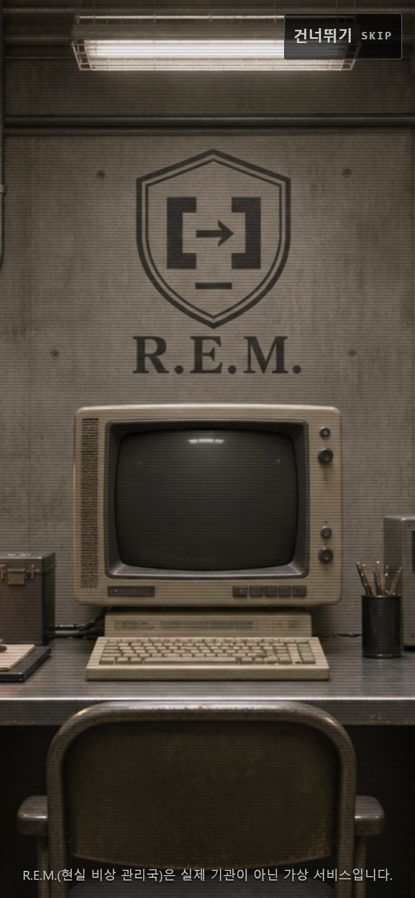
  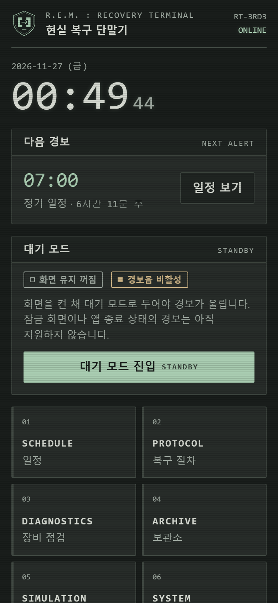
  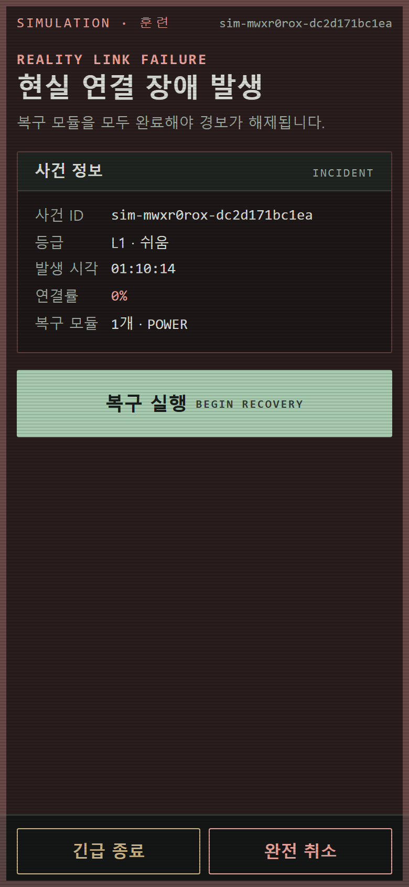
</p>

## 실제 실행 화면

모든 이미지는 구현된 앱을 실제로 실행해 캡처한 화면입니다(390×844, 훈련 모드).

| 입장 → 부팅 | 메인 | 일정 등록 |
|---|---|---|
| 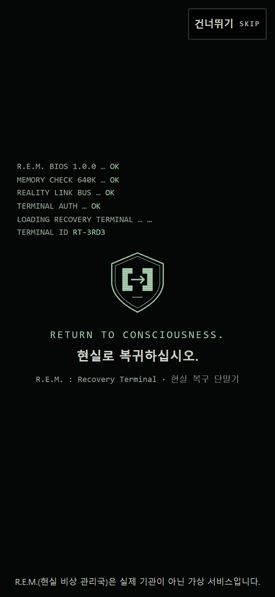 |  | 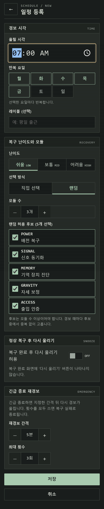 |

| 비상 경보 | POWER 배전반 | SIGNAL 오실로스코프 |
|---|---|---|
|  | 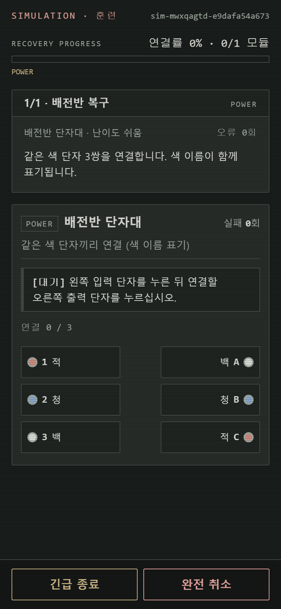 | 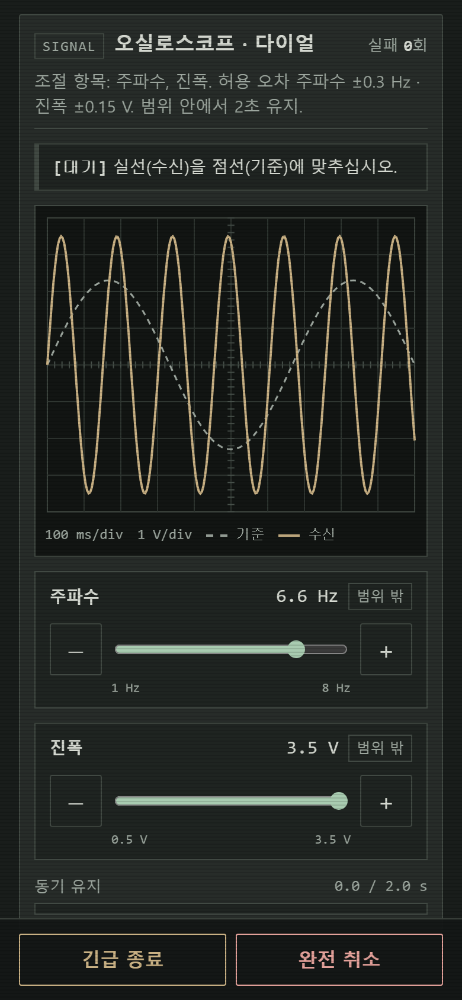 |

| MEMORY 진단 격자 | GRAVITY 항공 자세계 | ACCESS 키패드 |
|---|---|---|
| 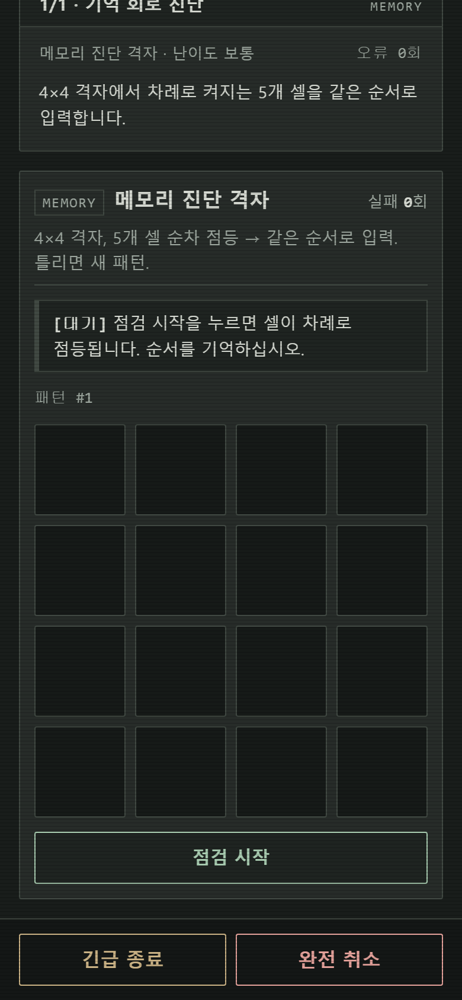 | 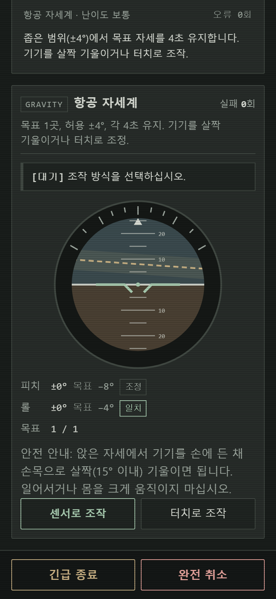 | 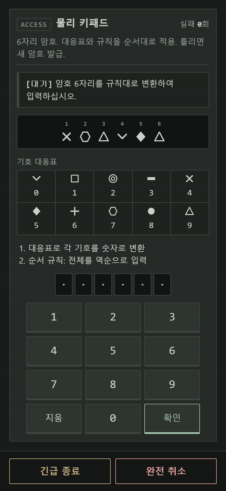 |

| 복구 완료 | 사건 보고서 | 보관소 |
|---|---|---|
| 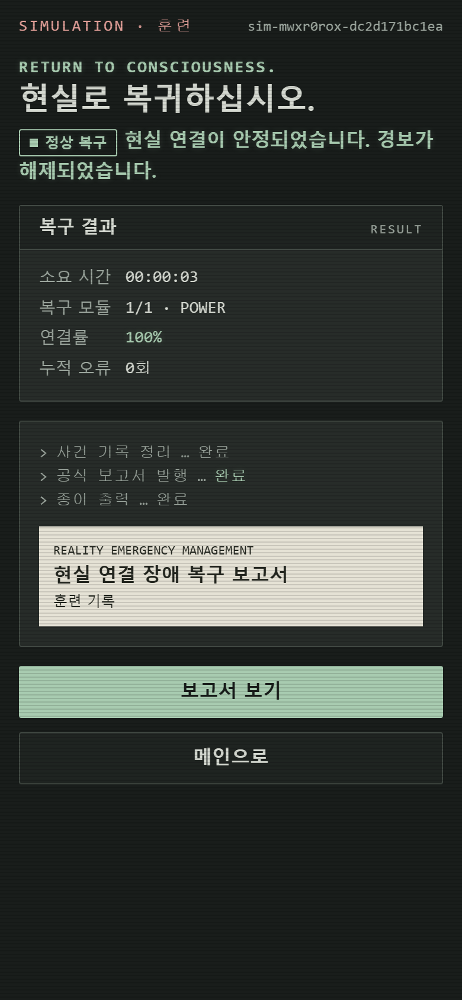 | 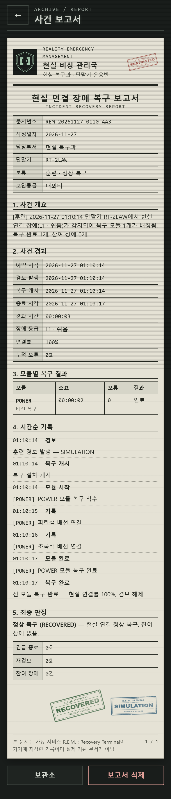 | 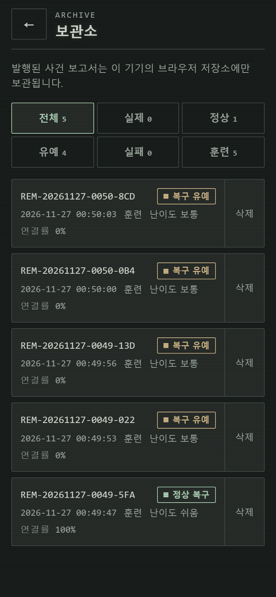 |

PC 화면(1440×900):

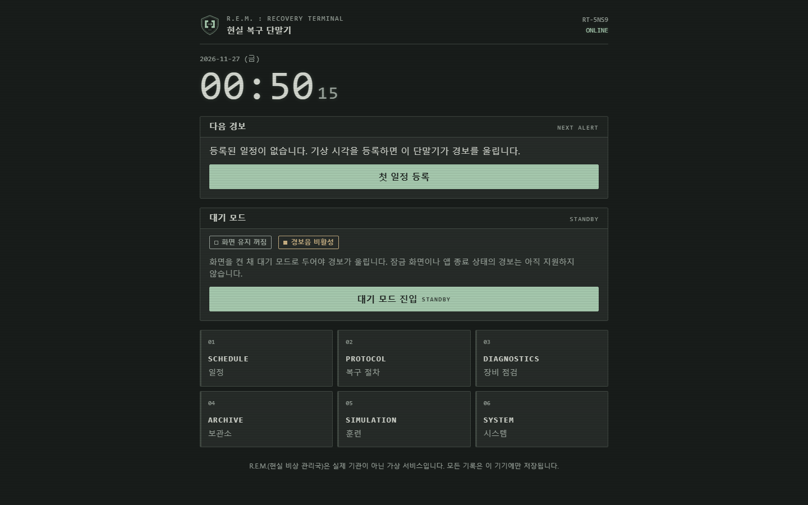

## 핵심 기능

- **입장 연출**: 지하 비상 복구실 → CRT 모니터 줌인 → 부팅 → 단말기. 앱에 들어올 때마다 재생되고(경보 화면으로 바로 들어올 때는 생략) 건너뛰기를 지원하며, 모션 최소화 설정을 따릅니다.
- **복수 알람**: 요일 반복과 1회성 알람, 켜기/끄기, 수정·삭제, 다음 경보까지 남은 시간 표시.
- **복구 프로토콜 설정**: 난이도 3단계(쉬움/보통/어려움), 복구 모듈 1~5개, 직접 선택(순서 지정)과 허용 풀 랜덤 선택.
- **5종 복구 모듈 × 3단계 난이도**: 문제는 매번 무작위로 생성되며 실패 횟수 제한이 없습니다.
  - POWER: 배전반 단자대. 색만 표시된 단자를 손가락이나 마우스로 끌어 같은 색끼리 선을 그려 잇습니다. 쉬움 3쌍, 보통 5쌍, 어려움 7쌍.
  - SIGNAL: 오실로스코프·다이얼. 주파수, 진폭, 위상을 기준 파형에 맞추고 2초간 유지.
  - MEMORY: 메모리 진단 격자. 3×3/3개, 4×4/5개, 5×5/7개 순차 점등을 기억 후 입력.
  - GRAVITY: 항공 자세계. 기기를 살짝 기울여 자세를 맞추며, 센서 미지원·거부 시 터치로 조작.
  - ACCESS: 물리 키패드. 기호→숫자 대응, 순서 규칙, 자리별 연산 규칙.
- **경보 정책**:
  - 긴급 종료: 1~10분 뒤 재경보, 최대 1~10회. 소진되면 실패로 종료합니다.
  - 정상 복구 후 다시 울리기: 허용 여부와 간격(1~10분)·횟수(1~10회)를 설정합니다.
  - **완전 취소**: 항상 접근할 수 있으며 즉시 정지하고 대기 중인 재경보도 제거합니다.
  - 경보는 최대 30분 후 자동 종료됩니다.
  - 같은 시각의 알람은 하나의 사건으로 통합됩니다.
- **공식 사건 보고서**: 문서번호·단말기·분류, 사건 경과, 모듈별 소요 시간·오류, 시간순 기록, 최종 판정, 마모 직인(정상 복구/유예/실패/훈련/대외비). 보관소에서 전체/실제/정상/유예/실패/훈련으로 분류해 열람하고 삭제할 수 있습니다.
- **장비 점검**: 네트워크, 알림 권한·테스트 알림, 경보음 시험(직접 확인), 진동, 자세 센서. 미지원이나 거부는 정상으로 표시하지 않습니다.
- **훈련(SIMULATION)**: 설치 없이 즉시 체험할 수 있습니다. 실제 일정과 분리되며 보고서에 훈련 직인이 찍힙니다.
- **PWA**: 홈 화면 설치, 오프라인 실행, 화면 유지 대기 모드. 일반 브라우저에서는 설치 안내 팝업이 뜨고 설치된 앱에서는 뜨지 않습니다.
- **화면 설정**: UI 밝기(60~100%, 기기 밝기와는 별개), 주사선, 발광, 모션 최소화.

## 중요: 경보가 울리는 조건 (알려진 제한)

이 버전에는 **외부 푸시 알림 서버가 없습니다.** 따라서:

- 경보는 **앱이 열려 있고 화면이 켜져 있을 때** 울립니다. 메인 화면의 **대기 모드 진입** 버튼을 누르면 경보음이 활성화되고, 지원 브라우저에서는 화면이 꺼지지 않게 유지됩니다(Screen Wake Lock).
- **휴대폰이 잠겨 있거나 앱을 완전히 닫은 상태에서는 경보가 울리지 않습니다.** 앱을 백그라운드로 보내면 브라우저나 OS가 타이머와 소리를 멈출 수 있습니다.
- 앱을 다시 열었을 때 30분 이내에 놓친 경보가 있으면 곧바로 경보 화면을 띄우고, 그보다 오래된 경보는 건너뜁니다.
- 경보음은 **무음 모드에서도 울리도록** 설정되어 있습니다(iPhone 무음 스위치 포함, 실기기 미검증). 대신 **미디어 음량**을 따르므로 음량이 0이면 들리지 않습니다.
- 진동은 Vibration API를 지원하는 기기(주로 Android Chrome)에서만 동작합니다. iOS Safari는 지원하지 않습니다.
- 브라우저 정책상 경보음을 켜려면 한 번은 화면을 탭해야 합니다(대기 모드 진입 또는 복구 실행).
- POWER 모듈은 색으로만 구분하므로 색각 이상이 있으면 풀기 어려울 수 있습니다. 이 경우 알람 설정에서 POWER를 빼고 다른 모듈을 선택하십시오.

## 지원 환경

| 환경 | 상태 |
|---|---|
| 데스크톱 Chromium(Chrome) 최신, 360~1440px 뷰포트 | 자동화 브라우저(Playwright headless)로 검증 |
| iPhone Safari / 홈 화면 PWA | **실기기 미검증** |
| Android Chrome / 설치 PWA | **실기기 미검증** |
| Firefox, Safari(macOS), Edge | 미검증 |

설치(홈 화면 추가):

- iPhone Safari: 공유 버튼 → **홈 화면에 추가**
- Android Chrome: 메뉴 → **앱 설치** (또는 앱 안의 설치 버튼)
- PC Chrome/Edge: 주소창 오른쪽의 설치 아이콘
- 카카오톡 등 인앱 브라우저: 외부 브라우저(Safari/Chrome)로 연 뒤 설치

## 사용 방법

1. https://sodam-wd.github.io/rem/ 에 접속합니다. 설치하지 않고 바로 써도 되고, 위 방법으로 설치해도 됩니다.
2. **DIAGNOSTICS(장비 점검)** 에서 알림, 경보음, 진동, 센서를 확인합니다.
3. **SCHEDULE(일정)** 에서 기상 시각, 요일, 난이도, 복구 모듈, 재경보 정책을 등록합니다.
4. 잠들기 전에 메인 화면에서 **대기 모드 진입**을 누르고 화면을 켠 채 충전기에 연결해 둡니다.
5. 경보가 울리면 **복구 실행** → 모듈을 모두 완료 → 경보 해제 → 보고서 발행.
6. **ARCHIVE(보관소)** 에서 지난 보고서를 분류해 열람합니다.
7. 먼저 체험해 보려면 **SIMULATION(훈련)** 을 사용합니다.

## 데이터 관리

- 가입이나 로그인이 없습니다. 알람, 보고서, 설정은 모두 **이 기기 브라우저의 IndexedDB에만** 저장되며 서버로 전송되지 않습니다.
- 외부 네트워크 통신, 분석, 추적이 없습니다. 첫 접속 때 앱 파일을 받고, 이후 업데이트를 확인하는 것만 GitHub Pages와 통신합니다.
- **데이터가 사라지는 경우**: 브라우저 데이터·사이트 데이터 삭제, 시크릿 모드 종료, 기기 변경, 앱 삭제. 또 브라우저와 설치된 PWA는 저장소가 분리될 수 있습니다(특히 iOS).
- SYSTEM 화면의 **전체 데이터 삭제**로 모든 기록을 지울 수 있습니다. 보고서는 보관소에서 하나씩 삭제할 수도 있습니다.
- 백업/복원, PDF/인쇄 내보내기는 이번 버전에 없습니다.

## 개발자용

```bash
npm ci
npm run build     # 타입 검사 후 dist/ 생성 (base: /rem/)
npm run preview   # http://localhost:4173/rem/
```

React 19 + TypeScript + Vite, vite-plugin-pwa(Workbox), Web Audio, Screen Wake Lock, DeviceOrientation, Vibration, IndexedDB를 씁니다. `main` 브랜치에 push하면 GitHub Actions가 타입 검사·빌드 후 GitHub Pages에 배포합니다.

## 라이선스

[MIT](LICENSE). 사무실 배경 이미지, 공식 심볼, 직인 등 `public/assets/` 의 이미지는 이 프로젝트를 위해 제작된 리소스입니다.
